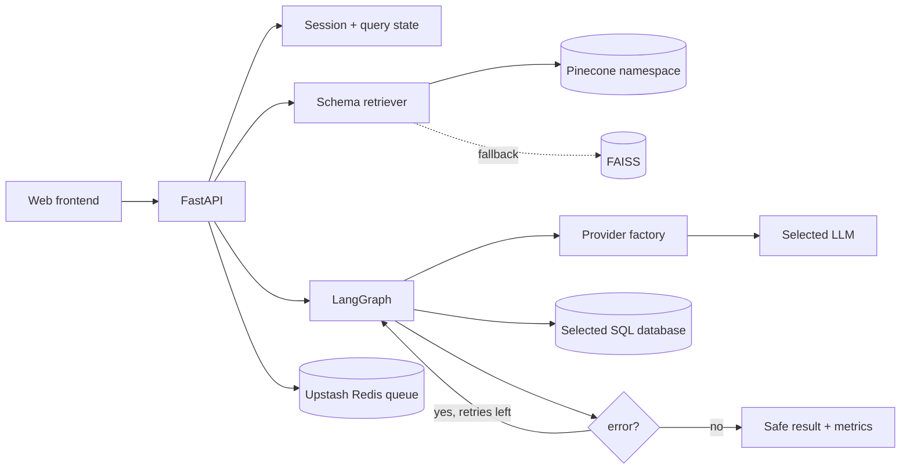

<div align="center">

# NerfSQL

### Ask your database a question. Get safe, executable SQL.

Schema-aware, self-correcting Text-to-SQL powered by LangGraph, FastAPI, Pinecone, and pluggable LLM providers.

[](https://www.python.org/)
[](https://fastapi.tiangolo.com/)
[](https://langchain-ai.github.io/langgraph/)
[](https://www.docker.com/)
[](LICENSE)

**[Live demo](https://nerfsql-demo.onrender.com/frontend/) · [API docs](https://nerfsql-demo.onrender.com/docs) · [Project handbook](artifacts/NerfSQL_AI_Engineer_Project_Handbook.pdf)**

</div>

---

## The idea

NerfSQL turns a plain-English question into a database answer through a controlled workflow:

```text
question → retrieve relevant schema → generate SQL → validate → execute safely
                                      ↑                         ↓
                                      └──── correct from error ──┘
```

The model does not receive an entire database blindly and it does not get unlimited retries. Each connection has an isolated schema namespace, each query carries its database/provider selection, and destructive SQL is rejected before execution.

## About NerfSQL

NerfSQL is an AI engineering portfolio project built to demonstrate how a reliable Text-to-SQL product is assembled beyond a single prompt. It combines retrieval, stateful orchestration, provider abstraction, database safety, encrypted connection profiles, deployment operations, and measurable evaluation in one small system.

The project deliberately separates what is implemented from what is still production work. The live demo is designed for learning and interviews; the roadmap documents the next steps required for authentication, durable metadata, stronger retrieval, and repeatable benchmark evidence.

## Why it is interesting

Most Text-to-SQL demos stop at “the model generated a query.” NerfSQL treats SQL generation as one step in a larger engineering system:

- **Schema-aware RAG** limits the prompt to tables relevant to the question.
- **LangGraph orchestration** makes state, transitions, and retries explicit.
- **Execution feedback** lets the system repair syntax and database errors.
- **Safety guardrails** allow read-only SQL and block destructive statements.
- **Multi-database support** keeps connection engines and Pinecone namespaces isolated.
- **Multi-provider support** lets a user select Groq, OpenAI, Anthropic, Gemini, or an OpenAI-compatible endpoint.
- **Operational endpoints** expose health, readiness, schema ingestion, history, and seed jobs.

## Architecture



### Query lifecycle

1. The frontend sends a question with optional `connection_id`, `provider_id`, `model`, and `schema_strategy`.
2. The retriever searches the selected connection's Pinecone namespace. If vectors are unavailable, the service can inspect that database live.
3. LangGraph passes the question and schema into the generation node.
4. Semantic validation checks whether the SQL can answer the question using the available tables.
5. The SQL guard rejects destructive or modifying statements.
6. The selected SQLAlchemy engine executes the read-only query.
7. On failure, the correction node receives the SQL, error, schema, and question. The loop is bounded by `MAX_RETRIES`.
8. The response records SQL, result, retries, connection/provider selection, and usage metadata.

## Technology map

| Layer | Implementation | Why it exists |
| --- | --- | --- |
| API | FastAPI | Typed HTTP endpoints, middleware, health checks, and docs |
| Agent workflow | LangGraph | Stateful nodes, conditional edges, and bounded correction |
| LLMs | Groq + provider factory | Default hosted model plus user-selected providers |
| Schema embeddings | FastEmbed / MiniLM | Lightweight local schema and question vectors |
| Vector search | Pinecone + FAISS fallback | Connection-scoped semantic retrieval |
| SQL access | SQLAlchemy | PostgreSQL, MySQL, and SQLite connections |
| Secret storage | Fernet encryption | Protects database URLs and provider credentials at rest |
| Queue | Upstash Redis | Rebuildable demo-data and background jobs |
| Deployment | Docker + Render | Reproducible container deployment |
| Demo database | Supabase PostgreSQL | Persistent external data for the live demo |

## Repository map

```text
NerfSQL/
├── app/                         # Production backend
│   ├── api.py                   # FastAPI routes and middleware
│   ├── main.py                  # Query orchestration and sessions
│   ├── core/                    # Settings and session state
│   ├── graph/                   # LangGraph state, nodes, and transitions
│   ├── db/                      # Connection profiles and SQL execution
│   ├── llm/                     # Provider factory, profiles, and prompts
│   ├── retriever/               # Pinecone/FAISS schema retrieval
│   ├── validators/              # Read-only SQL guardrails
│   ├── utils/                   # TOON parsing and shared helpers
│   └── queue.py                 # Upstash seed-job queue
├── api/index.py                 # Vercel adapter that exports app.api:app
├── frontend/                    # Static browser client
├── scripts/                     # Schema ingestion and demo-data jobs
├── tests/                       # Unit, integration, benchmark, and load tests
├── data/seed/                   # SQL seed/schema files
├── docs/                        # Architecture, benchmark, API, and interview docs
├── artifacts/                   # Generated DOCX/PDF project handbook
├── configs/                     # Model and database YAML configuration
├── Dockerfile                   # Render/container image
├── docker-compose.yml           # Local container with persistent data volume
├── render.yaml                  # Render service configuration
├── requirements.txt             # Runtime dependencies
└── .env.example                 # Safe configuration template
```

The detailed compatibility rules are in [`docs/PROJECT_STRUCTURE.md`](docs/PROJECT_STRUCTURE.md).

## Quick start

### Install

```bash
git clone https://github.com/sdm0p/NerfSQL.git
cd NerfSQL
python -m venv venv
```

```powershell
# Windows PowerShell
.\venv\Scripts\Activate.ps1
pip install -r requirements.txt
```

```bash
# macOS/Linux
source venv/bin/activate
pip install -r requirements.txt
```

### Configure

Copy `.env.example` to `.env` and set the values you use locally:

```env
GROQ_API_KEY=your_key
DB_URI=sqlite:///data/local.db
PINECONE_API_KEY=your_key
PINECONE_INDEX_NAME=nerfsql-schema
PINECONE_NAMESPACE=default
PINECONE_REGION=us-east-1
SECRETS_ENCRYPTION_KEY=your_fernet_key
```

Never commit `.env` or real API keys. Generate a Fernet key with:

```bash
python -c "from cryptography.fernet import Fernet; print(Fernet.generate_key().decode())"
```

### Create, ingest, and run

```bash
python scripts/create_sample_db.py
python scripts/ingest_schema.py --db_uri sqlite:///data/local.db --output data/schema_chunks.json
python run.py
```

Open `http://localhost:8000/frontend/` for the UI or `http://localhost:8000/docs` for Swagger.

### Docker

```bash
docker compose up --build
```

The Compose volume keeps `/app/data` persistent across container restarts. Render uses the same Docker image; its external Supabase, Pinecone, and Upstash services remain outside the container.

## API examples

```bash
curl http://localhost:8000/health
```

```bash
curl -X POST http://localhost:8000/query \
  -H "Content-Type: application/json" \
  -d '{"question":"Which customer spent the most?","schema_strategy":"rag"}'
```

| Method | Endpoint | Purpose |
| --- | --- | --- |
| GET | `/health` | Lightweight liveness check |
| GET | `/ready` | Readiness/configuration check |
| POST | `/connections` | Add and validate a database connection |
| GET | `/connections` | List connection metadata without secrets |
| POST | `/connections/{id}/schema/ingest` | Refresh a connection's vectors |
| POST | `/providers` | Add and validate an LLM provider profile |
| GET | `/providers` | List provider metadata without secrets |
| POST | `/query` | Run the agentic Text-to-SQL workflow |
| GET | `/history` | Review in-memory chat sessions |
| POST | `/jobs/seed` | Queue a rebuildable demo-data job |

## Evaluation

```bash
python -m tests.run_eval
python -m tests.run_metrics
```

The benchmark measures execution success, semantic correctness, retrieval Recall@K, hallucination rate, retries, token usage, and latency. See [`docs/BENCHMARK.md`](docs/BENCHMARK.md).

The earlier headline claims—90%+ accuracy, 45% hallucination reduction, 30% token reduction, and sub-200 ms p95—should be treated as targets until a completed benchmark report verifies them. Free-provider rate limits interrupted the latest full run.

## Security model

- Provider API keys, database URLs, and custom base URLs are encrypted with Fernet.
- Secret values are excluded from API responses and normal logs.
- Each connection gets its own SQLAlchemy engine and Pinecone namespace.
- The SQL guard blocks `DROP`, `DELETE`, `TRUNCATE`, `ALTER`, `INSERT`, `UPDATE`, and `CREATE`.
- The correction loop has a maximum retry budget.
- Custom provider URLs are validated against unsafe private/cloud-metadata targets.

For production, add authenticated tenant ownership, database-level read-only roles, persistent PostgreSQL metadata storage, rate limits, timeouts, and durable tracing. The current Render metadata store is still SQLite inside the container unless `CONNECTION_STORE_URI` points to external persistent storage.

## Current limitations

- Retrieval is currently dense top-K search; hybrid keyword search and reranking are roadmap items.
- A schema chunk is table-level, so business descriptions and FK-neighbor expansion can still improve recall.
- In-memory chat history does not survive a process restart.
- LLM and embedding cold starts affect the first request after deployment sleep.
- Provider quotas can interrupt a full benchmark run.

## Roadmap

1. Persistent PostgreSQL metadata and chat history.
2. Authentication and tenant ownership.
3. Database-level read-only roles, statement timeouts, and result limits.
4. Async schema indexing with durable job status.
5. Hybrid retrieval, foreign-key expansion, adaptive top-K, and reranking.
6. Provider fallback, circuit breakers, and cost-aware routing.
7. Durable traces and a completed reproducible benchmark report.

## Interview-ready summary

> NerfSQL is a stateful agentic Text-to-SQL system. It retrieves connection-specific schema context, asks a selected LLM to generate read-only SQL, validates the query semantically and syntactically, executes it against the selected database, and uses bounded error feedback to repair failures. LangGraph makes the workflow explicit, Pinecone reduces irrelevant schema context, and FastAPI exposes the system as a deployable service.

## Documentation

- [`docs/PROJECT_STRUCTURE.md`](docs/PROJECT_STRUCTURE.md) — architecture and compatibility rules
- [`docs/BENCHMARK.md`](docs/BENCHMARK.md) — evaluation methodology
- [`docs/NerfSQL_Documentation.md`](docs/NerfSQL_Documentation.md) — extended project notes
- [`docs/interview/INTERVIEW_PREP.md`](docs/interview/INTERVIEW_PREP.md) — interview preparation
- [`artifacts/NerfSQL_AI_Engineer_Project_Handbook.pdf`](artifacts/NerfSQL_AI_Engineer_Project_Handbook.pdf) — complete handbook

## License

MIT License.
